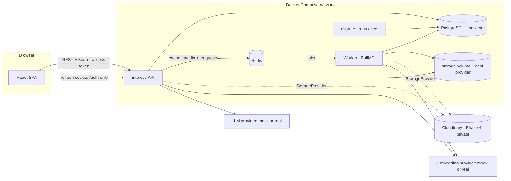
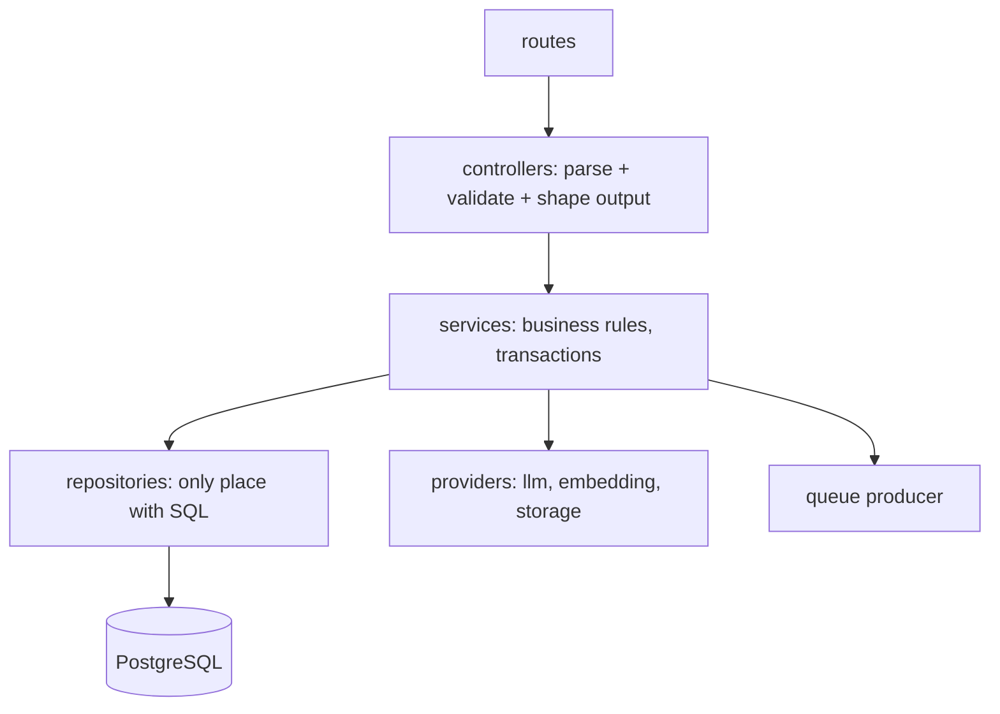
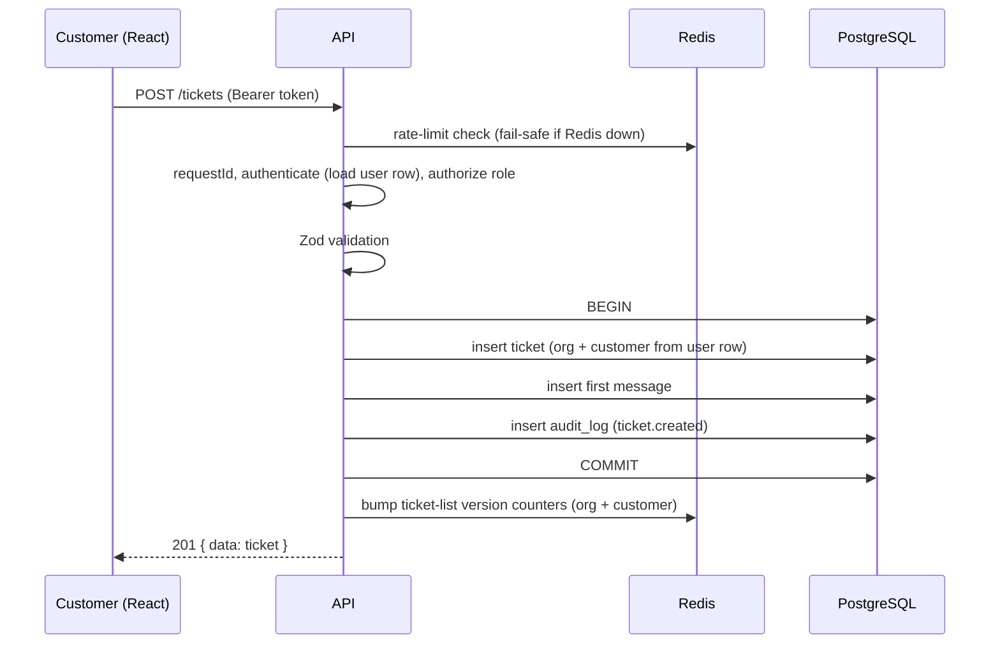
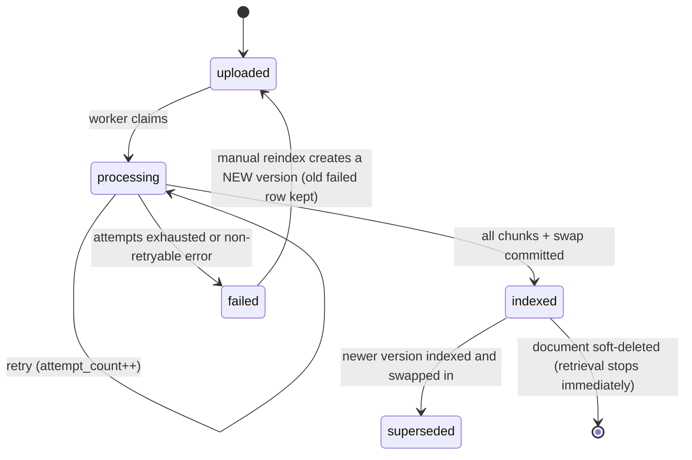
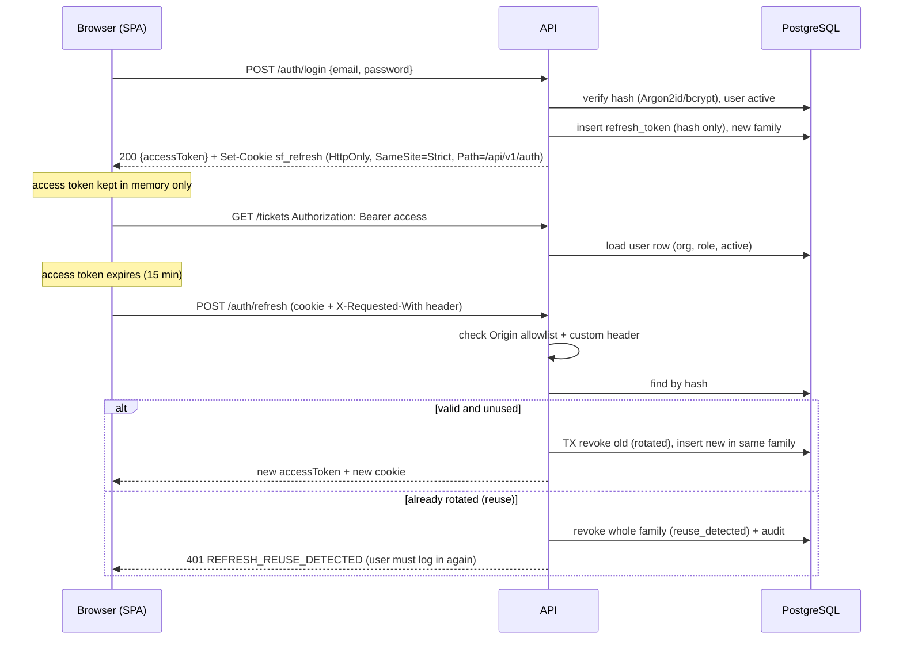

# ARCHITECTURE.md

> **Status: PLANNED.** Nothing here is implemented or verified yet.

## 1. System overview

In plain words: the browser talks to an Express API. The API reads and writes PostgreSQL, uses Redis for caching, rate limiting and a job queue, and hands slow work (reading PDFs, creating embeddings) to a separate **worker** process. The worker and API share code through a shared workspace package.



## 2. Technology and decisions

| Topic | Decision |
|---|---|
| Language/modules | JavaScript, **ES modules** everywhere (`"type": "module"`) |
| Node.js | Active LTS at Phase 1 start, verified on nodejs.org, pinned in `.nvmrc` and Dockerfile `ARG NODE_VERSION` |
| Package manager | **npm workspaces** (`frontend`, `backend/shared`, `backend/api`, `backend/worker`) |
| Test framework | **Vitest** for all packages; Supertest for API; React Testing Library for UI |
| Migrations | **`node-pg-migrate`** with SQL files, forward-only (verify SQL-file mode in Phase 1) |
| DB access | `pg` + repositories with plain SQL, no ORM |
| Validation | Zod |
| Logging | pino (JSON), request IDs, redaction list |
| Error format | One envelope everywhere (section 9) |
| Password hashing | Argon2id preferred, bcrypt fallback; Phase 1 spike decides; Debian-slim base images (not Alpine) to reduce native-module problems |
| Rate limiting | `rate-limiter-flexible` with Redis store and in-memory insurance limiter (verify in Phase 6) |
| Lint/format | ESLint + Prettier |

## 3. Backend layering



Rules: no SQL outside repositories; no business logic in routes/controllers; providers are behind interfaces; the worker uses the same services/repositories through `backend/shared`.

## 4. Ticket creation flow



## 5. Background ingestion with safe replacement

Core rule: **the last successfully indexed version stays searchable until a newer version is fully indexed and swapped in atomically.** A failed job only ever affects the new version row and its own chunks.

```mermaid
sequenceDiagram
  participant U as Agent
  participant A as API
  participant S as StorageProvider
  participant P as PostgreSQL
  participant Q as Redis/BullMQ
  participant W as Worker
  participant E as Embedding provider
  U->>A: POST /documents or PUT /documents/:id/file (multipart)
  A->>A: validate size, extension, MIME, %PDF- signature, filename
  A->>S: store file privately (key under org/document/version)
  A->>P: TX insert document (if new) + version(status=uploaded), audit
  A->>Q: enqueue ingest, jobId = ingest:{versionId}
  A-->>U: 202 { documentId, versionId, status: uploaded }
  Q->>W: job { versionId }  (no URLs or file paths in payload)
  W->>P: claim version: uploaded|processing -> processing (skip if already indexed)
  W->>S: read file
  W->>W: extract per-page text, chunk (never across pages)
  W->>E: embed chunks in batches (validate vector length == config dimensions)
  W->>P: insert chunks for (version, each active/staged config), scoped delete-then-insert
  W->>P: TX SWAP: version=indexed, document.active_version_id=new, previous active -> superseded
  W->>Q: enqueue cleanup: purge superseded chunks, delete unreferenced asset
  Note over W,P: On final failure: version=failed + safe error; delete only this version's chunks; active_version_id untouched
```

### Document-version state machine



What the document looks like to users: it shows the status of its **latest version** plus which version is **active/searchable**. Example: a replacement is `failed` while version 3 remains `active` and searchable ("Replacement failed. Version 3 is still in use.").

### Reconciler (closing the "DB committed but enqueue failed" gap)
A repeatable worker job every `RECONCILER_INTERVAL_MINUTES` finds versions stuck in `uploaded` or `processing` longer than `STUCK_JOB_MINUTES` with no live BullMQ job and re-enqueues them (same deterministic jobId). It also retries pending cleanup. This is a documented "outbox-lite" pattern chosen to avoid an extra outbox table in the MVP.

### Concurrency rules
- Claim is a conditional `UPDATE ... WHERE status IN (...)`; zero rows updated means skip.
- Two uploads/replacements of the same document at once: the later `version_number` wins at swap time only if it is newer than the active version's number; an older version finishing late never replaces a newer active one (swap checks `new.version_number > active.version_number`).
- Reindex = new version row that reuses the stored file (`origin='reindex'`).

## 6. RAG answer flow

```mermaid
sequenceDiagram
  participant G as Agent
  participant A as API
  participant P as PostgreSQL
  participant E as Embedding provider
  participant L as LLM provider
  G->>A: POST /tickets/:id/ai-suggestions
  A->>A: authenticate, role in (agent, admin), rate limit
  A->>P: load ticket WHERE id AND organization_id (404 if miss)
  A->>A: build query (subject + latest customer message), normalize
  A->>E: embed query (active indexing config)
  A->>P: vector search: org filter + active config + active versions only
  A->>A: similarity threshold
  alt nothing above threshold
    A->>P: store ai_response(outcome=insufficient_evidence), no LLM call
  else evidence found
    A->>L: rules + numbered context (data, not instructions) + question; JSON output
    L-->>A: JSON
    A->>A: strict parse; map cited numbers to retrieved chunk ids; drop invalid
    A->>P: TX store ai_response + ai_response_sources (snapshots) + audit
  end
  A-->>G: draft, outcome, sources
  G->>A: POST /ai-suggestions/:id/review (approve | edit_approve | reject | dismiss)
  A->>P: TX update review; on approve insert agent ticket_message(source=ai_approved) + audit
```

Details live in [AI_RAG_DESIGN.md](AI_RAG_DESIGN.md).

## 7. Authentication and refresh rotation



Full rules, CSRF reasoning and limits: [SECURITY.md](SECURITY.md).

## 8. Caching design (Redis)

**Cache isolation rules**
1. Keys are always `sf:{env}:v1:org:{orgId}:...`. Anything user-specific also contains `user:{userId}`.
2. **Customer data is never stored under a key shared with other users.** Customer ticket lists use `...:user:{userId}:...`; agent/admin lists use `...:staff:...` (staff see the whole org).
3. Query-dependent entries include a hash of the normalized query/filter and the user's role.
4. **Never cached:** authentication state, tokens, AI drafts, document text/chunks, signed URLs.
5. **Invalidation by version counters:** each scope has a counter key (for example `...:tickets:ver`). Reads build their key including the current counter value; any write increments the counter, so old entries become unreachable and expire by TTL. No key scanning.
6. All TTLs are short. Redis failure means **bypass the cache** (fail open for reads).

| Cache target | Key scope | TTL | Invalidated by |
|---|---|---|---|
| Ticket list (customer) | org + user + query hash | 30 s | ticket/message write for that customer |
| Ticket list (staff) | org + staff + role + query hash | 30 s | any ticket write in org |
| Document list | org + query hash | 60 s | document/version status change |
| Admin stats | org | 60 s | TTL only |
| Query embeddings | org + indexing config + SHA-256 of normalized text | 1 h | TTL (config change makes old keys unreachable) |

Ticket detail and messages are read straight from PostgreSQL in the MVP (correctness over speed).

**Rate limiting** (Redis-backed; separate key namespace `sf:{env}:rl:*`)

| Limiter | Key | Default |
|---|---|---|
| Login | IP + email | 10 / 15 min |
| Register | IP | 5 / hour |
| Refresh | IP | 60 / hour |
| General API | user id (IP if anonymous) | 300 / min |
| Document upload | user id | 20 / hour |
| AI suggestion | user id | `AI_REQUESTS_PER_USER_PER_HOUR` (30) |

Exceeding returns `429 RATE_LIMITED` with `Retry-After`.

## 9. Error format and conventions

All errors, from every route and the centralized handler:

```json
{ "error": { "code": "VALIDATION_ERROR", "message": "Human-readable summary", "details": [{ "field": "subject", "issue": "Must be 3-200 characters" }], "requestId": "7f1c..." } }
```

`details` is optional. Stack traces, SQL, file paths and secrets never appear. Success bodies are `{ "data": ... }` with `{ "meta": ... }` for pagination. The code catalogue is in [API_SPEC.md](API_SPEC.md).

## 10. Failure behavior

| Dependency down | Behavior |
|---|---|
| LLM provider | `POST /ai-suggestions` returns `503 AI_PROVIDER_UNAVAILABLE`; a failed attempt is recorded as `outcome=error`; tickets unaffected |
| Embedding provider (query) | same as above |
| Embedding provider (ingestion) | job retried with exponential backoff; if exhausted, version `failed`, active version untouched |
| Redis | cache bypassed; auth rate limiter uses in-memory insurance limiter; uploads and AI-queue-dependent actions return `503 QUEUE_UNAVAILABLE`; `/ready` fails |
| PostgreSQL | `503 DATABASE_UNAVAILABLE`; `/ready` fails; worker retries |
| Storage | upload `503 STORAGE_UNAVAILABLE` (DB row marked failed or rolled back so no orphan "uploaded" row without a file) |
| Worker crash mid-job | BullMQ stall detection retries; claim logic and scoped delete-then-insert keep it idempotent; reconciler catches stragglers |

## 11. Health, readiness, shutdown

- `GET /health`: process is alive, no dependency checks.
- `GET /ready`: checks PostgreSQL (`SELECT 1`) and Redis (`PING`); 200 or 503.
- Graceful shutdown (SIGTERM/SIGINT): stop accepting connections; finish in-flight HTTP requests with a timeout; worker stops fetching new jobs and lets the current job finish (or returns it to the queue); then close Redis and PostgreSQL pools.

## 12. Docker Compose services

| Service | Image/build | Purpose | Host port | Notes |
|---|---|---|---|---|
| postgres | pinned `pgvector/pgvector` tag (PG 16 or newer, verified in Phase 1) | DB + extension | `127.0.0.1:5432` (dev only) | named volume `pgdata`; healthcheck `pg_isready` |
| redis | `redis:7-alpine` (or current stable pinned) | queue, cache, limits | `127.0.0.1:6379` (dev only) | named volume with AOF; healthcheck `redis-cli ping` |
| migrate | backend image | runs migrations then exits | none | waits for postgres healthy |
| api | `backend/api/Dockerfile` | REST API | 4000 | waits for migrate completed + redis healthy; healthcheck `/health` |
| worker | `backend/worker/Dockerfile` | BullMQ processors, reconciler | none | same env, shares `storage` volume (local provider) |
| frontend | `frontend/Dockerfile` | dev Vite server; prod static build behind nginx | 5173 (dev) | `VITE_API_URL` at build time |

How services find each other: Compose gives them one private network and DNS names equal to the service names. Inside a container, `localhost` means *that container*, so the API uses `postgres:5432` and `redis:6379`.

Dev modes: (A) infra only in Docker and Node on the host in WSL (`docker compose up -d postgres redis` + `npm run dev`) for fast hot reload; (B) everything in Compose (`docker compose up --build`) to test the real topology. Native modules (argon2) are installed **inside** the image; the host `node_modules` is never mounted over the container's.

## 13. Cloudinary / private document strategy (summary)

- Uploads go through the API (Multer memory storage, hard size limit), are validated, then written through `StorageProvider`.
- Cloudinary assets use **authenticated** delivery under `supportflow/{env}/{orgId}/...`. Only the `storage_key` is stored. **No permanent public URL is ever stored or returned.**
- Access: `GET /documents/:id/download-url` checks role + organization and returns a **short-lived** URL (`SIGNED_URL_TTL_SECONDS`); issuance is audit-logged.
- Local provider: URL is an API route carrying an HMAC token bound to version id and expiry; the file is streamed with `Content-Disposition` and `X-Content-Type-Options: nosniff`.
- The worker never receives URLs; it reads the file through `StorageProvider` using the version id.
- **Phase 4 verification spike, required before relying on Cloudinary**: confirm from current Cloudinary documentation and a real test upload of a synthetic PDF that (1) authenticated raw assets are not retrievable by unsigned URL, (2) the chosen signed/expiring URL mechanism really expires and is available on our account plan, (3) account-level PDF delivery restrictions do not block it, (4) deletion removes the asset and what happens to cached/CDN copies, (5) free-plan limits. Record results in the evidence log. If it fails, remain on `local` or another documented provider.
- Deleting: soft delete → retrieval stops immediately → cleanup job deletes assets that **no remaining version references**.

## 14. Planned repository layout

```
supportflow/
  AGENTS.md README.md PROJECT_PLAN.md ARCHITECTURE.md DATABASE_SCHEMA.md API_SPEC.md
  AI_RAG_DESIGN.md SECURITY.md TESTING.md DEPLOYMENT.md INTERVIEW_GUIDE.md
  .gitignore .env.example .nvmrc docker-compose.yml package.json
  .github/workflows/ci.yml
  frontend/            src/{api,components,pages,hooks,context,routes,utils}, Dockerfile
  backend/
    shared/            src/{config,db,repositories,providers/{llm,embedding,storage},ai,queue,logger,errors}
                       migrations/
    api/               src/{routes,controllers,services,middleware,validators,app.js,server.js}, Dockerfile
    worker/            src/{processors,worker.js}, Dockerfile
  docs/                diagrams/ rag-eval/ screenshots/ demo-script.md evidence/
  samples/knowledge-base/   synthetic policy PDFs
  scripts/             seed, spikes, indexing admin scripts
```
Reasoning for `backend/shared`: API and worker both need repositories, config and providers, and duplicating them invites drift.

## 15. Implementation status

| Component | Status |
|---|---|
| Everything above | 🗓 Planned |
