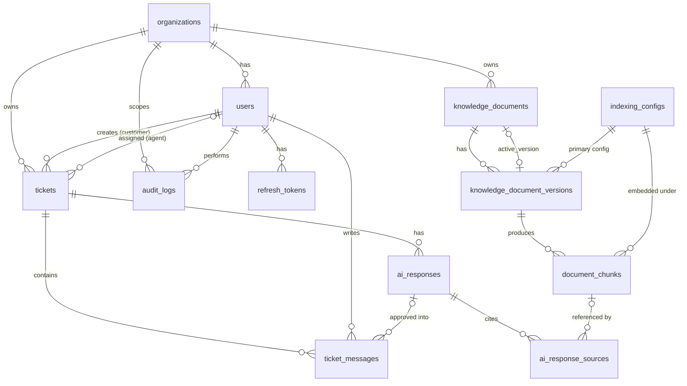

# DATABASE_SCHEMA.md

> **Status: PLANNED.** No migration has been written or applied. Snippets are illustrative, not executed.

This document refines the approved blueprint schema with two documented changes made while preparing the docs:

1. **Document versions** are a separate table (`knowledge_document_versions`) so a failed re-upload or re-index can never destroy the last successfully indexed version.
2. **Embedding configurations** are a table (`indexing_configs`) and the vector column is **dimensionless**, so mock and real embeddings (with different dimensions) are handled safely.

## 1. Conventions

- Primary keys: `uuid DEFAULT gen_random_uuid()`.
- Timestamps: `timestamptz`; every table has `created_at NOT NULL DEFAULT now()`; mutable tables also `updated_at` (maintained by a trigger or the repository layer; decided in Phase 2).
- Enumerations: `text` + `CHECK` (easier to evolve than native ENUM).
- Every tenant-owned table has `organization_id uuid NOT NULL REFERENCES organizations`.
- Extensions: `vector` (pgvector), `citext`.
- Migrations: SQL files managed by `node-pg-migrate`, **forward-only** in shared environments, numbered, reviewed, never edited after being applied. Database changes only through migrations.

## 2. ER diagram



## 3. Tables

### organizations
Purpose: tenant boundary. MVP seeds one.
| Column | Type | Constraints |
|---|---|---|
| id | uuid | PK |
| name | text | NOT NULL |
| slug | text | NOT NULL UNIQUE, CHECK `^[a-z0-9-]{3,50}$` |
| created_at, updated_at | timestamptz | |
Retention: never hard-deleted in MVP.

### users
Purpose: identity, role, organization membership (one org per user in MVP).
| Column | Type | Constraints |
|---|---|---|
| id | uuid | PK |
| organization_id | uuid | FK → organizations, NOT NULL |
| email | citext | NOT NULL |
| password_hash | text | NOT NULL (self-describing Argon2id/bcrypt string) |
| full_name | text | NOT NULL, CHECK length 1–120 |
| role | text | NOT NULL, CHECK in `customer, agent, admin` |
| is_active | boolean | NOT NULL DEFAULT true |
| password_changed_at | timestamptz | NOT NULL DEFAULT now() |
| created_at, updated_at | timestamptz | |

Unique: `(organization_id, email)`. Index: `(organization_id, role)`.
Deletion: deactivate (`is_active=false`), never hard-delete (preserves history; FKs use RESTRICT).

### refresh_tokens
Purpose: server-side record of rotating refresh sessions.
| Column | Type | Constraints |
|---|---|---|
| id | uuid | PK |
| user_id | uuid | FK → users ON DELETE CASCADE |
| family_id | uuid | NOT NULL (all rotations of one login share it) |
| token_hash | text | NOT NULL UNIQUE (SHA-256 hex of the opaque token; the token itself is never stored) |
| expires_at | timestamptz | NOT NULL (idle lifetime) |
| family_expires_at | timestamptz | NOT NULL (absolute lifetime, copied across rotations) |
| revoked_at | timestamptz | NULL |
| revoked_reason | text | NULL, CHECK in `rotated, logout, reuse_detected, password_changed, deactivated, admin` |
| replaced_by | uuid | NULL, FK → refresh_tokens |
| user_agent_hash | text | NULL (optional soft signal) |
| created_at | timestamptz | |

Indexes: `(user_id)`, `(family_id)`, `(expires_at)` for purge. Retention: purge rows 30 days after expiry/revocation (kept briefly for reuse detection and audit).

### tickets
| Column | Type | Constraints |
|---|---|---|
| id | uuid | PK |
| organization_id | uuid | FK, NOT NULL |
| customer_id | uuid | FK → users, NOT NULL |
| assigned_agent_id | uuid | FK → users, NULL |
| subject | text | NOT NULL, CHECK length 3–200 |
| status | text | NOT NULL DEFAULT `open`, CHECK in `open, in_progress, resolved` |
| priority | text | NOT NULL DEFAULT `medium`, CHECK in `low, medium, high, urgent` |
| category | text | NULL, CHECK length ≤ 60 |
| resolved_at | timestamptz | NULL |
| search_tsv | tsvector | generated from subject (and first message body if decided in Phase 2) |
| created_at, updated_at | timestamptz | |

Check: `status='resolved'` ⇔ `resolved_at IS NOT NULL` (enforced by CHECK).
Indexes (from real query patterns):
- `(organization_id, status, priority, created_at DESC)` agent list/filter
- `(customer_id, created_at DESC)` customer list
- `(assigned_agent_id, status)` "my tickets"
- GIN on `search_tsv` search

Deletion: no hard delete in MVP (audit); FKs RESTRICT.
Application invariant (service + test): assigned agent must belong to the same organization and have role agent/admin.

### ticket_messages (immutable)
| Column | Type | Constraints |
|---|---|---|
| id | uuid | PK |
| ticket_id | uuid | FK → tickets ON DELETE CASCADE |
| organization_id | uuid | FK, NOT NULL |
| author_id | uuid | FK → users, NOT NULL |
| author_role | text | NOT NULL, CHECK in `customer, agent, admin` |
| body | text | NOT NULL, CHECK length 1–10000 |
| source | text | NOT NULL DEFAULT `human`, CHECK in `human, ai_approved` |
| ai_response_id | uuid | NULL, FK → ai_responses |
| created_at | timestamptz | |

Index: `(ticket_id, created_at)`. CHECK: `source='ai_approved'` ⇔ `ai_response_id IS NOT NULL`.
Rule: an `ai_approved` message is always authored by the **reviewing human** (the agent who approved).

### indexing_configs
Purpose: a versioned "recipe" for how chunks are produced and embedded. Retrieval only compares vectors created under the same config.
| Column | Type | Constraints |
|---|---|---|
| id | uuid | PK |
| name | text | NOT NULL UNIQUE (e.g. `mock-hash-v1-384`) |
| provider | text | NOT NULL (`mock`, or the real provider later) |
| model | text | NOT NULL |
| dimensions | integer | NOT NULL, CHECK 1 ≤ dimensions ≤ 4000 |
| distance_metric | text | NOT NULL DEFAULT `cosine`, CHECK in `cosine` (MVP) |
| normalize | boolean | NOT NULL DEFAULT true |
| chunk_size_chars | integer | NOT NULL |
| chunk_overlap_chars | integer | NOT NULL, CHECK < chunk_size_chars |
| status | text | NOT NULL, CHECK in `staged, active, retired` |
| verified_at | timestamptz | NULL (set when dimensions were confirmed by a real provider call; always NULL for mock) |
| verification_note | text | NULL (how it was verified, which docs, which date) |
| created_at | timestamptz | |

Constraints: `UNIQUE (id, dimensions)` (target of a composite FK); **partial unique index** `ON indexing_configs ((true)) WHERE status='active'` ensures exactly one active config. Seeded: the mock config.

### knowledge_documents (logical document)
| Column | Type | Constraints |
|---|---|---|
| id | uuid | PK |
| organization_id | uuid | FK, NOT NULL |
| created_by | uuid | FK → users, NOT NULL |
| title | text | NOT NULL, CHECK length 1–200 |
| active_version_id | uuid | NULL, FK → knowledge_document_versions (**DEFERRABLE INITIALLY DEFERRED**) |
| deleted_at | timestamptz | NULL (soft delete) |
| created_at, updated_at | timestamptz | |

Index: `(organization_id) WHERE deleted_at IS NULL`.
`active_version_id` points at the last **successfully indexed** version, i.e. the only one retrieval may use. NULL means "nothing searchable yet".

### knowledge_document_versions
Purpose: one row per uploaded/re-indexed file version. Holds file facts and processing state.
| Column | Type | Constraints |
|---|---|---|
| id | uuid | PK |
| document_id | uuid | FK → knowledge_documents ON DELETE CASCADE |
| organization_id | uuid | FK, NOT NULL |
| version_number | integer | NOT NULL, CHECK ≥ 1 |
| origin | text | NOT NULL, CHECK in `upload, replace, reindex` |
| uploaded_by | uuid | FK → users, NOT NULL |
| original_filename | text | NOT NULL (sanitized) |
| mime_type | text | NOT NULL (must be `application/pdf`) |
| size_bytes | bigint | NOT NULL, CHECK > 0 |
| sha256 | char(64) | NOT NULL |
| storage_provider | text | NOT NULL (`local`, `cloudinary`) |
| storage_key | text | NOT NULL (local relative path or Cloudinary public_id; **never a permanent URL**) |
| status | text | NOT NULL, CHECK in `uploaded, processing, indexed, failed, superseded` |
| page_count | integer | NULL |
| attempt_count | integer | NOT NULL DEFAULT 0 |
| error_code | text | NULL |
| error_message | text | NULL (safe, user-readable, no internals) |
| processing_started_at | timestamptz | NULL |
| indexed_at | timestamptz | NULL |
| created_at, updated_at | timestamptz | |

Unique: `(document_id, version_number)`. Indexes: `(document_id, version_number DESC)`, `(organization_id, sha256)` (non-unique: re-index versions legitimately share a hash; duplicate-upload detection is a service check, a documented small race), `(status, updated_at)` for the reconciler.
State: `superseded` = was active, replaced by a newer indexed version. See ARCHITECTURE.md state diagram.
Several versions may reference the same `storage_key` (re-index). The asset is deleted only when **no** remaining version references it.

### document_chunks
Purpose: searchable text pieces with embeddings.
| Column | Type | Constraints |
|---|---|---|
| id | uuid | PK |
| organization_id | uuid | FK, NOT NULL (denormalized on purpose so retrieval filters without a join) |
| document_id | uuid | FK → knowledge_documents ON DELETE CASCADE |
| document_version_id | uuid | FK → knowledge_document_versions ON DELETE CASCADE |
| indexing_config_id | uuid | NOT NULL |
| embedding_dimensions | integer | NOT NULL |
| chunk_index | integer | NOT NULL, CHECK ≥ 0 |
| page_number | integer | NOT NULL, CHECK ≥ 1 |
| content | text | NOT NULL |
| content_sha256 | char(64) | NOT NULL |
| char_count | integer | NOT NULL |
| embedding | **vector** (no dimension) | NOT NULL |
| created_at | timestamptz | |

Constraints:
- `UNIQUE (document_version_id, indexing_config_id, chunk_index)` → makes ingestion idempotent.
- `FOREIGN KEY (indexing_config_id, embedding_dimensions) REFERENCES indexing_configs (id, dimensions)` → a chunk can only claim its config's dimensions.
- `CHECK (vector_dims(embedding) = embedding_dimensions)` → the actual vector must have exactly that many numbers.
Indexes: `(organization_id)`, `(document_version_id, indexing_config_id)`, plus **one partial HNSW expression index per indexing config** (below).

### ai_responses
| Column | Type | Constraints |
|---|---|---|
| id | uuid | PK |
| organization_id | uuid | FK, NOT NULL |
| ticket_id | uuid | FK → tickets |
| requested_by | uuid | FK → users |
| indexing_config_id | uuid | FK → indexing_configs |
| query_text | text | NOT NULL (what was embedded) |
| trigger_message_id | uuid | NULL, FK → ticket_messages (latest customer message used) |
| outcome | text | NOT NULL, CHECK in `answered, insufficient_evidence, conflicting_evidence, error` |
| draft_body | text | NULL (non-null iff outcome='answered') |
| suggested_category | text | NULL |
| suggested_priority | text | NULL, CHECK in priority set |
| review_status | text | NOT NULL DEFAULT `pending_review`, CHECK in `pending_review, approved, edited_approved, rejected, dismissed` |
| reviewed_by | uuid | NULL FK → users |
| reviewed_at | timestamptz | NULL |
| final_body | text | NULL (the text actually sent if approved) |
| provider, model | text | NOT NULL (`mock` is recorded as such) |
| prompt_version | text | NOT NULL |
| latency_ms | integer | NULL |
| input_tokens, output_tokens | integer | NULL |
| top_similarity | real | NULL |
| error_code | text | NULL |
| created_at, updated_at | timestamptz | |

Index: `(ticket_id, created_at DESC)`. CHECK: reviewed fields are all-set or all-null.

### ai_response_sources
Purpose: what the model was shown, as a **snapshot**, so history stays truthful after documents change.
| Column | Type | Constraints |
|---|---|---|
| id | uuid | PK |
| ai_response_id | uuid | FK ON DELETE CASCADE |
| organization_id | uuid | FK, NOT NULL |
| chunk_id | uuid | NULL, FK → document_chunks ON DELETE SET NULL |
| document_id | uuid | NOT NULL (no FK; survives document removal) |
| document_version_id | uuid | NOT NULL (no FK) |
| document_title | text | NOT NULL |
| page_number | integer | NOT NULL |
| similarity | real | NOT NULL |
| rank | integer | NOT NULL (the number shown to the model, 1..k) |
| cited_in_answer | boolean | NOT NULL |
| snippet | text | NOT NULL (copy of the passage text) |
Unique: `(ai_response_id, rank)`.

### audit_logs (append-only)
| Column | Type | Constraints |
|---|---|---|
| id | uuid | PK |
| organization_id | uuid | FK, NOT NULL |
| actor_id | uuid | NULL FK → users (NULL for system) |
| action | text | NOT NULL (e.g. `ticket.status_changed`) |
| entity_type | text | NOT NULL |
| entity_id | uuid | NULL |
| metadata | jsonb | NOT NULL DEFAULT '{}' (never secrets, tokens, passwords, or message bodies) |
| request_id | text | NULL |
| ip | inet | NULL |
| created_at | timestamptz | |
Indexes: `(organization_id, created_at DESC)`, `(entity_type, entity_id)`. The application's DB role gets INSERT and SELECT only (no UPDATE/DELETE) on this table; privileges set in a migration.

Audited actions (minimum): `auth.login_succeeded`, `auth.login_failed`, `auth.refresh_reuse_detected`, `auth.logout`, `auth.password_changed`, `user.created`, `user.role_changed`, `user.activated/deactivated`, `ticket.created`, `ticket.assigned`, `ticket.status_changed`, `ticket.priority_changed`, `document.uploaded/replaced/reindexed/deleted`, `document.download_url_issued`, `document.version_activated`, `ai.suggestion_requested`, `ai.suggestion_approved/edited_approved/rejected/dismissed`, `admin.indexing_config_changed`.

## 4. How pgvector stores and indexes embeddings

An **embedding** is a list of N decimal numbers representing the meaning of a text. pgvector stores it in a `vector` column. Similar meanings give vectors pointing in similar directions; **cosine distance** (`<=>`) is small for similar vectors. Similarity reported to users = `1 - cosine_distance`.

**Why dimensionless?** A column declared `vector(768)` accepts only 768-number vectors, and an HNSW index needs a known dimension. Different providers use different sizes, and our mock provider uses its own. A dimensionless `vector` column plus `embedding_dimensions`, the composite FK, and the `vector_dims` CHECK keeps every row honest while allowing more than one config to coexist. Switching providers becomes *add a config, backfill, switch*, not *rewrite the table*.

**Index per config** (illustrative, to be created by a script/migration when a config is created):

```sql
-- illustrative only; <config-uuid> and 384 come from the indexing_configs row
CREATE INDEX document_chunks_hnsw_<short-id>
  ON document_chunks
  USING hnsw ((embedding::vector(384)) vector_cosine_ops)
  WHERE indexing_config_id = '<config-uuid>';
```

Query rules that follow from this:
- The query must use the **same expression** (`embedding::vector(384)`) and a **literal** matching `indexing_config_id = '<config-uuid>'` so Postgres can use the partial index. Dimension and uuid are inlined by the repository from the trusted `indexing_configs` row after strict validation (integer / UUID parsing). They are **never** taken from request input.
- Verify with `EXPLAIN` in Phase 5. Note that on tiny tables Postgres will choose a sequential scan anyway, which is correct behavior.
- Building a new index on a live table uses `CREATE INDEX CONCURRENTLY` (outside a transaction).
- HNSW limits: the `vector` type indexes up to 2,000 dimensions; larger sizes need a different representation (for example `halfvec` expression indexes, or a provider-supported smaller output size). **Verify these limits against the installed pgvector version** before picking a real model.
- HNSW is approximate. Filters (organization, active version) are applied after the index scan, so retrieval over-fetches candidates (`RETRIEVAL_CANDIDATE_LIMIT`) and filters, then takes top-k. Scaling options (partial indexes per tenant, iterative scans in newer pgvector) are Phase 9 topics.

## 5. Safe retrieval shape (illustrative)

```sql
WITH candidates AS (
  SELECT c.id, c.document_id, c.document_version_id, c.page_number, c.content,
         (c.embedding::vector(384) <=> $1::vector(384)) AS distance
  FROM document_chunks c
  WHERE c.organization_id = $2
    AND c.indexing_config_id = '<active-config-uuid>'
  ORDER BY c.embedding::vector(384) <=> $1::vector(384)
  LIMIT 50
)
SELECT cand.*, d.title
FROM candidates cand
JOIN knowledge_documents d
  ON d.id = cand.document_id
 AND d.active_version_id = cand.document_version_id   -- only the active version is searchable
 AND d.deleted_at IS NULL
WHERE d.organization_id = $2
ORDER BY cand.distance
LIMIT $3;
```

Then the application applies the similarity threshold.

## 6. Tenant isolation and ownership rules

1. `organization_id` and `role` used for authorization come from the **database row of the authenticated user**, loaded on every request. They are never taken from the request body, query string, or token claims.
2. Every tenant-owned query includes `organization_id = $orgId`.
3. Customers additionally filter ticket queries by `customer_id = $userId`.
4. IDs received from clients are loaded **with** the org (and ownership) predicate. A miss returns `404 NOT_FOUND`, never `403`, to avoid confirming that a resource exists elsewhere.
5. Retrieval filters organization **in SQL** and joins to the active, non-deleted version. Unauthorized chunks are never fetched and then filtered in application code.
6. Customers have no access to documents, chunks, AI drafts, or sources.
7. Cache keys and background-job payloads carry the organization and are validated against the database record when processed.
8. Hardening option for Phase 9: PostgreSQL Row-Level Security as defense in depth.

## 7. Retention and deletion summary

| Data | Behavior |
|---|---|
| Users | Deactivate only |
| Tickets, messages | Retained (no delete endpoint in MVP) |
| Documents | Soft delete. Retrieval stops immediately (join excludes it). Chunks purged and storage assets deleted by cleanup jobs |
| Versions | `superseded` versions' chunks purged after a successful swap; file asset kept while referenced; old versions' rows kept for history |
| Failed versions | Partial chunks removed; row kept with an error message |
| refresh_tokens | Purged 30 days after expiry/revocation |
| ai_responses / sources | Retained (snapshot) |
| audit_logs | Retained; retention period is a deployment decision |

## 8. Planned migration order

| # | Migration | Phase |
|---|---|---|
| 0001 | extensions: `vector`, `citext` | 1 |
| 0002 | organizations, users | 2 |
| 0003 | refresh_tokens | 2 |
| 0004 | tickets, ticket_messages (+ indexes, search) | 2 |
| 0005 | audit_logs (+ privilege restrictions) | 2 |
| 0006 | indexing_configs, knowledge_documents, knowledge_document_versions, document_chunks (+ seeded mock config and its HNSW index) | 4 |
| 0007 | ai_responses, ai_response_sources; add `ticket_messages.ai_response_id` FK | 5 |
| 0008+ | real provider config row + index (after dimension verification); further changes | 5+ |

Because `ticket_messages.ai_response_id` references a table created later, 0004 creates the column without the FK and 0007 adds the constraint.

## 9. Commands (planned)

```bash
npm run migrate            # apply pending migrations
npm run migrate:status     # list applied/pending
npm run migrate:create -- <name>   # new migration file
npm run db:psql            # psql shell inside the postgres container
npm run test:db            # DB integration tests against supportflow_test
```
