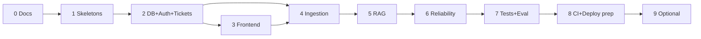

# PROJECT_PLAN.md

> **Status: Phase 0 complete when the owner approves these documents. No application code exists.**

## 1. Status legend and evidence rule

| Status | Meaning |
|---|---|
| 🗓 Planned | designed in docs only |
| 🛠 Implemented | code exists but is not yet proven |
| ✅ Verified | proven by a recorded command/test/check in the **evidence log** (section 9) with date, commit, command and result |

A feature may only be marked ✅ when its evidence-log row exists. A passing run with mock providers is recorded as such and never counts as proof of real-AI behavior.

## 2. Product requirements (concise PRD)

**Problem.** Support teams answer the same policy questions repeatedly, and wrong answers are costly.
**Solution.** A ticketing platform where agents upload policy PDFs; for a ticket, the system retrieves relevant passages and drafts a reply with citations (document + page) that a human reviews. When evidence is missing the system says so.

**Roles:** customer (own tickets), agent (org tickets, documents, AI review), admin (agent powers plus users, audit logs, stats).

**Non-functional requirements:** no cross-customer or cross-organization access; AI output never sent or resolved automatically; citations validated server-side; full pipeline testable offline with deterministic mock providers; reproducible with Docker Compose; honest, measured claims only.

**Success criteria:** runs from a clean clone; tests actually run and honestly reported; reproducible RAG evaluation; the owner can explain every design decision.

## 3. MVP scope and deferrals

**In the MVP:** auth (register/login/refresh rotation/logout), roles, tickets (CRUD, messages, assignment, status/priority, search/filter/sort/pagination, transition rules), audit logs, PDF knowledge base (upload, validation, local then Cloudinary storage, background ingestion, page-aware chunking, embeddings, versions, safe replace/reindex/delete), AI suggestions with citations and human review, caching, rate limiting, retries/idempotency, health/readiness/graceful shutdown, React UI, tests, CI, Docker Compose, docs.

**Deferred:** multi-org per user and invitations; email notifications and email-to-ticket; WebSockets (polling/refresh instead); ticket attachments; OCR; hybrid search and re-ranking; streaming responses; customer-facing AI chat; metrics dashboards; SSO/MFA/password-reset email; non-PDF documents; Row-Level Security (Phase 9 option).

**Tenant decision:** schema is tenant-ready (`organization_id` everywhere); MVP seeds one organization; one org per user; no memberships table.

## 4. Decision log

| ID | Decision | Rationale / notes |
|---|---|---|
| D1 | JavaScript with **ES modules** everywhere; Node Active LTS pinned in `.nvmrc` and Dockerfiles | consistency; verify LTS on nodejs.org at Phase 1 |
| D2 | **npm workspaces** monorepo | no extra tooling for a beginner |
| D3 | **Vitest** for all tests; Supertest; React Testing Library | one runner, fast |
| D4 | **node-pg-migrate**, SQL files, forward-only; raw SQL via `pg`, no ORM | explicit SQL, pgvector control. Verify SQL-file mode in Phase 1; if unsuitable, document an alternative before switching |
| D5 | Zod, pino, helmet, strict CORS allowlist, ESLint, Prettier | |
| D6 | One error envelope `{error:{code,message,details?,requestId}}` | see API_SPEC |
| D7 | **Password hashing: Argon2id preferred, bcrypt fallback.** Decided by Phase 1 spike in our Docker image; Debian-slim images | **Final choice: Argon2id adopted.** Spike on `node:22-slim` verified clean native compilation, 76.5 ms hash / 65.2 ms verify vs bcrypt 201.6 ms / 197.8 ms. Memory-hard OWASP settings (19 MiB, t=2, p=1). |
| D8 | Access JWT 15 min in memory; opaque rotating refresh token in HttpOnly SameSite=Strict cookie scoped to `/api/v1/auth`; CSRF via custom header + Origin allowlist; same-site deployment | SECURITY.md §2–3 |
| D9 | Dimensionless pgvector column + `indexing_configs` + composite FK + `vector_dims` CHECK + partial HNSW per config; staged→active switching | Handles mock (384) vs real (verified, unknown) dimensions. DATABASE_SCHEMA.md, AI_RAG_DESIGN.md §3 |
| D10 | `knowledge_document_versions` + `active_version_id` swap | failed jobs never destroy last indexed version. ARCHITECTURE.md §5 |
| D11 | Mock providers first; real provider chosen **in Phase 5** after verifying actual dimensions with a live call and owner approval | no assumption of 768 |
| D12 | `StorageProvider`: local volume first; Cloudinary authenticated delivery in Phase 4 **after verification spike** | never permanent public URLs |
| D13 | `rate-limiter-flexible` (Redis store + insurance limiter) | verify in Phase 6 |
| D14 | PDF extraction with `pdfjs-dist` evaluated in Phase 4 spike (per-page text, Node compatibility); parsing in worker only | alternative documented if spike fails |
| D15 | Frontend: React, Vite, Tailwind, React Router, fetch-based API client, no global state library, no data-fetching library in MVP | Tailwind setup per the installed major version's docs (verify in Phase 3) |
| D16 | Compose dev modes: infra-only + host Node (A) or full stack (B) | DEPLOYMENT.md §3 |
| D17 | Document status shown to users = latest version status + which version is active | API_SPEC §2.4 |
| D18 | Reconciler job (outbox-lite) instead of an outbox table | simpler MVP; documented trade-off |

## 5. Feature tracker

| Feature | Phase | Status |
|---|---|---|
| Docker Compose (postgres+pgvector, redis, api, worker, frontend, migrate) | 1 | ✅ |
| `/health`, `/ready`, request IDs, structured logs, env validation | 1 | ✅ |
| Argon2id vs bcrypt spike | 1 | ✅ |
| Migrations 0001–0005, auth, refresh rotation, CSRF controls | 2 | ✅ |
| RBAC, ownership checks, tenant isolation tests | 2 | ✅ |
| Ticket CRUD, messages, assignment, transitions, search, pagination | 2 | ✅ |
| Audit logging | 2 | ✅ |
| React app (auth, customer, agent, admin pages) | 3 | ✅ |
| StorageProvider (local), upload validation, PDF extraction, chunking | 4 | ✅ |
| Mock embedding provider, indexing_configs, chunk persistence | 4 | ✅ |
| BullMQ ingestion, retries, idempotency, reconciler | 4 | ✅ |
| Safe replace / reindex / delete | 4 | ✅ |
| Cloudinary provider (after verification spike) | 4 | 🗓 |
| Retrieval, citation validation, mock LLM, human review UI | 5 | ✅ |
| Real provider selection and dimension verification | 5 | 🗓 |
| Redis caching, rate limiting, shutdown, failure behavior | 6 | ✅ |
| Full test matrix, security tests, RAG evaluation | 7 | ✅ |
| CI, prod compose, demo seed, README polish | 8 | ✅ |
| Optional improvements | 9 | 🗓 |

## 6. Phases

Rule: **do not start a phase while an earlier phase's acceptance criteria are failing.** Each phase ends with: tests run (actual output recorded), docs updated, evidence-log entries added, Git commit/tag.

---

### Phase 0: Requirements, architecture, documentation, Git

- **Objective:** an approved, consistent blueprint and a clean repository.
- **Dependencies:** none.
- **Files:** the 11 docs, `.gitignore`, `.env.example`.
- **Steps:** create repo folder in WSL → copy docs → `git init` → first commit → create **private** GitHub repo → push.
- **Commands:**
  ```bash
  mkdir -p ~/projects/supportflow && cd ~/projects/supportflow
  git init -b main
  git add . && git commit -m "docs: phase 0 blueprint"
  git remote add origin <your-private-repo-url> && git push -u origin main
  ```
- **Expected result:** repo on GitHub with docs; no `.env` committed (`git ls-files | grep -i "^.env$"` prints nothing).
- **Acceptance criteria:** owner approved docs; docs consistent (checklist delivered with them); `.env` ignored; no secrets in history.
- **Failure scenarios:** committed secret (rotate it, rewrite history before pushing); CRLF issues.
- **Tests:** none (document review checklist).
- **Interview questions:** Why design the schema before coding? What is a decision log for?

---

### Phase 1: Development environment and skeletons

- **Objective:** a running skeleton of every service with health checks, proving the toolchain.
- **Dependencies:** Phase 0; Windows setup done.
- **Files/modules:** root `package.json` (workspaces), `.nvmrc`, `docker-compose.yml`, three Dockerfiles, `backend/shared` (config with Zod env validation, logger, pg pool, redis client, error classes), `backend/api` (Express app, request-id middleware, error handler, `/health`, `/ready`, graceful shutdown), `backend/worker` (BullMQ worker with a harmless `ping` queue/job, graceful shutdown), `frontend` (Vite+React+Tailwind page that shows API health), ESLint/Prettier/Vitest configs, migration `0001` (extensions), `scripts/spikes/password-hash` (Argon2id vs bcrypt in container).
- **Steps:** 1) init workspaces and tooling; 2) compose with Postgres (pgvector image) + Redis + healthchecks; 3) migration runner and `0001`; 4) API skeleton and tests; 5) worker skeleton; 6) frontend skeleton; 7) Dockerfiles and full-stack compose; 8) password-hash spike; 9) docs update.
- **Commands:**
  ```bash
  docker compose up -d postgres redis && docker compose ps
  npm install && npm run migrate
  docker compose exec postgres psql -U supportflow -d supportflow -c "\dx"
  npm test && npm run lint
  docker compose up --build        # full stack
  curl localhost:4000/health && curl localhost:4000/ready
  ```
- **Expected results:** `vector` and `citext` listed by `\dx`; `/health` 200; `/ready` 200, and 503 after `docker compose stop redis`; worker log shows it processed a `ping` job; frontend shows API status; `docker compose stop` shuts services down cleanly (no killed-by-timeout).
- **Acceptance criteria:** all services healthy; missing env var causes a clear startup failure (test); `/ready` reflects dependency state; unit tests green; spike outcome recorded in D7; Node version pinned; no secrets committed.
- **Failure scenarios:** pgvector image missing extension; `localhost` vs service-name mix-ups; Windows line endings; port conflicts; native module build failure.
- **Tests:** env validation, health/ready (with DB/Redis up and down), error handler envelope, request-id propagation, password-hash spike script.
- **Interview questions:** What does a Compose healthcheck do? Why separate API and worker? Liveness vs readiness?

---

### Phase 2: Migrations, authentication, authorization, tickets

- **Objective:** secure identity and a complete ticket domain, with tenant isolation proven.
- **Dependencies:** Phase 1 verified.
- **Files/modules:** migrations 0002–0005; repositories (users, refresh_tokens, tickets, messages, audit); services (auth, users, tickets); middleware (authenticate, requireRole, validate, csrf-origin guard); Zod schemas; routes/controllers; seed script (synthetic org, users); audit service.
- **Steps:** schema migrations → auth service (hash, JWT, refresh rotation with reuse detection, cookie) → auth endpoints → authenticate/authorize middleware → ticket services (transition rules, ownership) → ticket endpoints (search/filter/sort/pagination) → audit hooks → seed → docs.
- **Commands:** `npm run migrate && npm run test:integration && npm run test:security`
- **Expected results:** register→login→refresh→logout flow works; ticket flows by role behave per API_SPEC.
- **Acceptance criteria:** every endpoint in API_SPEC §2.1–2.3 implemented; role matrix and cross-customer/cross-org tests pass; refresh rotation + reuse + race tests pass; invalid transitions rejected; audit entries exist; migrations apply to an empty database and are idempotent via the runner; no password hash or token ever in responses/logs (test).
- **Failure scenarios:** IDOR via UUID guessing; token reuse; concurrent status updates (use conditional updates); duplicate email race (unique constraint).
- **Tests:** see TESTING.md rows for Phase 2.
- **Interview questions:** authentication vs authorization; why 404 instead of 403; how refresh rotation works; why server-side org derivation.

---

### Phase 3: Frontend

- **Objective:** a usable, responsive SaaS-style UI over the real API.
- **Dependencies:** Phase 2 verified.
- **Files/modules:** API client (access token in memory, single-flight refresh, one retry, error envelope parsing), auth context, protected routes (UX only), layout/navigation, pages: login, register, customer dashboard, ticket create, ticket detail/conversation, agent dashboard (filters, search, pagination), assignment/status controls, admin dashboard (users, audit logs), shared components (loading, empty, error, form fields).
- **Steps:** tooling and Tailwind → API client → auth flow → customer pages → agent pages → admin pages → states and accessibility → component tests.
- **Commands:** `npm run dev`, `npm run test:frontend`
- **Expected results:** each role sees only its pages; reload keeps the session via refresh.
- **Acceptance criteria:** all Phase 3 pages work against the API; loading/empty/error/success states exist; forms have labels and keyboard support; customer cannot reach agent pages **and** the API still enforces it (tested); no token in localStorage/sessionStorage; component tests green.
- **Failure scenarios:** double refresh storms; stale UI after status change; rendering user text as HTML (forbidden).
- **Tests:** component tests per TESTING.md.
- **Interview questions:** why keep the access token in memory; why UI guards aren't security; how the API client handles 401.

---

### Phase 4: Storage, PDF ingestion, chunking, embeddings, queue

- **Objective:** documents become searchable chunks safely, using mock embeddings and local storage; Cloudinary added after verification.
- **Dependencies:** Phase 2 (Phase 3 for UI parts).
- **Files/modules:** migration 0006; `StorageProvider` (local, then cloudinary); upload middleware (Multer memory) and validators; document services/repositories; `EmbeddingProvider` interface + mock; chunker; PDF extractor; BullMQ queue/producer; worker ingest processor, cleanup processor, reconciler; indexing-config scripts; documents UI; Cloudinary verification spike notes in `docs/evidence/`.
- **Steps:** migration and config seed (mock 384) → storage local → upload endpoint + validation → version rows + audit → queue + worker claim → extract/chunk (unit-tested on synthetic PDFs) → embed + persist → atomic swap → replace/reindex/delete → reconciler/cleanup → UI → **Cloudinary spike** → Cloudinary provider (only if spike passes) .
- **Commands:** `docker compose up -d postgres redis`, `npm run test:integration`, `docker compose kill -s KILL worker` during a job (then restart) to observe recovery.
- **Expected results:** valid PDF → `indexed` with chunks (page numbers, config id, dimensions); invalid files rejected; killing the worker mid-ingestion then restarting ends `indexed` without duplicate chunks.
- **Acceptance criteria:** upload validation matrix passes; extraction/chunking tests pass; DB rejects dimension mismatches; retries/backoff and non-retryable failures behave; idempotency test passes; **replacing an indexed document with a corrupt PDF leaves the previous version active and searchable**; successful replacement swaps atomically; delete stops retrieval immediately; private download works only through short-lived signed access; Cloudinary evidence recorded before enabling it.
- **Failure scenarios:** enqueue failure after commit (reconciler); orphan assets; encrypted/scanned PDF; huge PDF; provider timeout; duplicate upload.
- **Tests:** TESTING.md Phase 4 rows.
- **Interview questions:** why a queue; how idempotency is achieved; what happens if the worker dies; why version rows.

---

### Phase 5: Retrieval, RAG generation, citations, human approval, real provider selection

- **Objective:** grounded drafts with validated citations and human review; then choose a real provider safely.
- **Dependencies:** Phase 4 verified.
- **Files/modules:** migration 0007; retrieval repository (partial-index SQL); prompt builder (versioned); `LlmProvider` + mock; RAG service; citation validator; AI endpoints; review flow; UI AI panel (sources, snippet view, signed "open page" link, approval controls, mock badge); real-provider adapters (after approval).
- **Steps:** mock end-to-end → validators → insufficient-evidence path → review/approval → UI → injection tests → **provider selection**: read docs, owner approves spend, live dimension verification, create staged config, backfill, evaluate, activate (AI_RAG_DESIGN.md §3 runbook).
- **Commands:** `npm run test:integration`, `npm run eval:mock`; real runs only via `npm run test:real-providers` after approval.
- **Expected results:** answerable question → draft with valid doc+page citations; unanswerable → `insufficient_evidence` with no LLM call; approved draft appears as an agent message; ticket status unchanged.
- **Acceptance criteria:** all Phase 5 tests pass; fabricated citations never persisted; cross-org retrieval returns nothing; `EXPLAIN` evidence for index use on a realistic synthetic dataset (not a tiny table) recorded; real provider dimensions verified and recorded **before** any real config is created; mock/real configs coexist without mixing.
- **Failure scenarios:** model returns invalid JSON; provider timeout; stale cited document; low-similarity noise; injection in PDF.
- **Interview questions:** how citations are validated; why a threshold; what cosine similarity is; how you'd switch embedding models safely.

---

### Phase 6: Redis caching, rate limiting, reliability

- **Objective:** performance and resilience behaviors with proof.
- **Dependencies:** Phase 5.
- **Files/modules:** cache service (version-counter keys), rate-limit middleware (Redis + insurance), failure-mode handling, shutdown handling, structured error codes for dependency failures, reconciler hardening.
- **Commands:** `npm run test:integration`; manually `docker compose stop redis` / `stop postgres` and observe behavior.
- **Acceptance criteria:** cache isolation tests (customer vs customer vs staff vs org) pass; invalidation tests pass; 429 with `Retry-After`; failure table in ARCHITECTURE.md §10 matches observed behavior; graceful shutdown test passes.
- **Failure scenarios:** cross-user cache leak; stale cache after write; Redis flapping; limiter blocking everyone when Redis is down.
- **Interview questions:** cache invalidation strategies; fail-open vs fail-closed; why version counters.

---

### Phase 7: Test completion and RAG evaluation

- **Objective:** close test gaps and produce an honest evaluation baseline.
- **Dependencies:** Phases 2–6.
- **Files:** remaining tests, `docs/rag-eval/*`, evaluation script, sample PDFs.
- **Commands:** `npm test && npm run test:integration && npm run test:security && npm run eval:mock`; optional approved `npm run eval:real`.
- **Acceptance criteria:** every row of the TESTING.md matrix is implemented or explicitly marked deferred with a reason; results logged with real output; mock and real evaluation results separate; thresholds for CI set from the first baseline.
- **Failure scenarios:** flaky tests; evaluation set overfit to retrieval settings (keep a held-out subset).
- **Interview questions:** how you measure retrieval quality; what hit@k and MRR mean; how mock results differ from real.

---

### Phase 8: Hardening, CI, deployment preparation, portfolio

- **Objective:** production-minded polish. **No public deployment or paid resources without approval.**
- **Dependencies:** Phase 7.
- **Files:** `.github/workflows/ci.yml`, `docker-compose.prod.yml`, demo seed/script, README with real screenshots, deployment guide updates, security checklist walk-through.
- **Acceptance criteria:** CI green on a clean clone; production checklist in DEPLOYMENT.md reviewed item by item; README quick start verified from scratch on a clean machine/folder; screenshots are real.
- **Interview questions:** how you'd deploy this; what's in your CI; how you'd roll back.

---

### Phase 9: Optional improvements

Candidates: hybrid search, re-ranking, metrics/monitoring, streaming, Row-Level Security, load tests (with measured numbers only), `is_searchable` flag + per-tenant partial indexes for scale, email notifications. Each starts with a short design note and acceptance criteria.

## 7. Phase dependency overview



## 8. Assumptions and open items

| # | Item | Resolution point |
|---|---|---|
| A1 | Single seeded organization in MVP | fixed |
| A2 | Text-based PDFs only; scanned PDFs fail with a clear message | fixed |
| A3 | Customers never see documents or raw drafts; only approved agent messages | fixed |
| A4 | Polling, not WebSockets | fixed |
| A5 | Chunks do not cross page boundaries | fixed (revisit after evaluation) |
| O1 | Argon2id vs bcrypt | Phase 1 spike |
| O2 | Real LLM/embedding provider, model, dimensions | Phase 5, owner approval + live verification |
| O3 | Cloudinary suitability for private PDFs | Phase 4 spike |
| O4 | Similarity threshold, top-k, chunk size | Phase 7 evaluation |
| O5 | `pdfjs-dist` suitability | Phase 4 spike |
| O6 | `node-pg-migrate` SQL mode, `rate-limiter-flexible` fit | Phase 1 / 6 |
| O7 | Hosting target and any deployment | Phase 8+, owner decision |
| O8 | Whether AI suggestion generation should become queued | after Phase 6 latency observations |

## 9. Evidence log

| Date | Phase | Claim verified | Command / check | Environment (mock/real) | Commit | Result |
|---|---|---|---|---|---|---|
| 2026-10-11 | 1 | PostgreSQL extensions (`vector` 0.8.7, `citext` 1.6) | `docker compose exec postgres psql -U supportflow -d supportflow -c "\dx"` | local docker | phase-1 | Both extensions installed and active |
| 2026-10-11 | 1 | Migration runner & 0001_extensions | `npm run migrate` | local docker | phase-1 | 0001_extensions applied cleanly via node-pg-migrate |
| 2026-10-11 | 1 | Unit & component tests (15/15 passed) | `npm test` | local node v22 | phase-1 | 5 test files, 15 tests passed (config, error envelope, request ID, health routes, React UI) |
| 2026-10-11 | 1 | Code quality / Lint | `npm run lint` | local node v22 | phase-1 | Passed with 0 errors, 0 warnings |
| 2026-10-11 | 1 | Password hashing spike (Argon2id vs Bcrypt) | `docker run --rm supportflow-spike node scripts/spikes/password-hash.js` | Debian-slim container | phase-1 | Argon2id avg 76.5ms hash / 65.2ms verify (OWASP 19MB, t=2, p=1); Bcrypt avg 201.6ms / 197.8ms. Argon2id adopted. |
| 2026-10-11 | 1 | Full-stack Docker Compose topology | `docker compose ps` | local docker | phase-1 | postgres (healthy), redis (healthy), api (healthy), worker (running), frontend (running) |
| 2026-10-11 | 1 | API /health and /ready endpoints | `curl http://localhost:4000/health && curl http://localhost:4000/ready` | local docker | phase-1 | `/health` returned 200 `status: ok`; `/ready` returned 200 `database: true, redis: true` |
| 2026-10-11 | 1 | /ready dependency failure & recovery | `docker compose stop redis && curl http://localhost:4000/ready` | local docker | phase-1 | 503 `DEPENDENCY_UNAVAILABLE` with `details: {database:true, redis:false}`; returned 200 on restart |
| 2026-10-11 | 1 | BullMQ background worker ping job | `docker compose logs worker` | local docker | phase-1 | Worker enqueued and completed ping job: `{pong: true}` |
| 2026-10-11 | 1 | Frontend web application | `curl http://localhost:5173` | local docker | phase-1 | HTTP 200 OK, Vite + React + Tailwind service dashboard loaded |
| 2026-10-11 | 2 | Schema migrations 0002–0005 | `npm run migrate` | local postgres | phase-2 | Created organizations, users, refresh_tokens, tickets, ticket_messages, audit_logs; foreign keys, check constraints, GIN FTS index verified |
| 2026-10-11 | 2 | Complete test suite (43/43 passed) | `npm test` | local node v22 | phase-2 | 10 test files passed, 43 tests passed, 0 failed, 0 skipped across shared, api, and frontend |
| 2026-10-11 | 2 | Auth & refresh token rotation + reuse detection | `npm run test:integration` | local postgres | phase-2 | Argon2id login, rotation, reuse revokes entire family with REFRESH_REUSE_DETECTED, logout revocation passed (8 tests) |
| 2026-10-11 | 2 | CSRF protection & origin validation | `npm run test:security` | local api | phase-2 | Rejects missing X-Requested-With and foreign Origins on cookie endpoints with 403 CSRF_REJECTED (3 tests) |
| 2026-10-11 | 2 | Tenant & customer isolation scoping | `npm run test:security` | local postgres | phase-2 | Cross-tenant and cross-customer queries return 404 NOT_FOUND (never disclosing existence), customer blocked from admin APIs (7 tests) |
| 2026-10-11 | 2 | Ticket lifecycle, transitions, FTS | `npm run test:integration` | local postgres | phase-2 | Atomic creation, agent/admin assignment, open->resolved requiring agent message check, auto-reopen on message, search passed (5 tests) |
| 2026-10-11 | 2 | User administration & last admin invariant | `npm run test:integration` | local postgres | phase-2 | Admin creates/manages users; cannot demote or deactivate sole remaining active admin with LAST_ACTIVE_ADMIN violation (5 tests) |
| 2026-10-11 | 2 | Synthetic test seed script | `npm run seed` | local postgres | phase-2 | Seeded demo-org, 1 admin, 2 agents, 2 customers, 3 tickets successfully |
| 2026-10-11 | 2 | Code quality / Lint | `npm run lint` | local node v22 | phase-2 | Passed with 0 errors, 0 warnings |
| 2026-10-12 | 3 | React production build | `npm run build -w @supportflow/frontend` | local node v22 | phase-3 | Vite bundled 1621 modules cleanly into dist/ with zero errors |
| 2026-10-12 | 3 | Frontend component & client tests (23/23 passed) | `npm run test:frontend` | local node v22 | phase-3 | 7 test files, 23 tests passed (API client in-memory token/single-flight refresh, ProtectedRoute, Login, CustomerDashboard, TicketDetail, AdminUsers) |
| 2026-10-12 | 3 | Full test suite (65/65 passed) | `npm test` | local node v22 + docker | phase-3 | 16 test files, 65 tests passed across backend unit/integration/security and frontend components |
| 2026-10-12 | 3 | Frontend live SPA serving | `curl http://localhost:5173` | local docker | phase-3 | HTTP 200 OK, React SPA index HTML loaded |
| 2026-10-12 | 3 | Code quality / Lint | `npm run lint` | local node v22 | phase-3 | Passed with 0 errors, 0 warnings |
| 2026-10-12 | 4 | Migration 0006: Knowledge Base schema | `npm run migrate` | local postgres | phase-4 | Created `indexing_configs` (seed `mock-hash-v1-384`), `knowledge_documents`, `knowledge_document_versions`, `document_chunks` with composite FK `(indexing_config_id, embedding_dimensions)` and `vector_dims()` check |
| 2026-10-12 | 4 | Ingestion Unit Tests (16/16 passed) | `npx vitest run tests/unit` | local node v22 | phase-4 | 3 test files, 16 tests passed (`pdfExtractor`: valid extraction, `PDF_CORRUPT`, `PDF_NO_TEXT`, `PDF_TOO_MANY_PAGES`; `chunker`: page boundary isolation, contiguous chunk indexes, boundary preferences; `mockEmbeddingProvider`: deterministic feature hashing, L2 normalization, production refusal) |
| 2026-10-12 | 4 | Document Domain & Ingestion Integration Tests (24/24 passed) | `npm run test:integration` | local postgres | phase-4 | 4 test files, 24 tests passed (upload, worker ingestion to `indexed`, safe replacement invariant where corrupt replacement keeps active version searchable, 409 duplicate SHA-256 conflict, signed URL download token verification, reindexing, and soft delete) |
| 2026-10-12 | 4 | Document Security & Tenant Isolation Tests (13/13 passed) | `npm run test:security` | local postgres | phase-4 | 3 test files, 13 tests passed (cross-organization access returns 404, customer role blocked with 403 on all document endpoints, forged/expired signed URL tokens rejected with 403) |
| 2026-10-12 | 4 | Frontend UI & Component Tests (26/26 passed) | `npm run test:frontend` | local node v22 | phase-4 | 8 test files, 26 tests passed (including KnowledgeDocuments listing, upload modal, empty state, and status display) |
| 2026-10-12 | 4 | Complete Test Suite (93/93 passed) | `npm test` | local node v22 + docker | phase-4 | 22 test files, 93 passed tests, 0 failed, 0 skipped |
| 2026-10-12 | 4 | Code quality & Production Build | `npm run lint && npm run build` | local node v22 | phase-4 | ESLint passed with 0 errors/0 warnings; Vite built 1622 modules cleanly |
| 2026-10-12 | 5 | Migration 0007: AI Responses & Snapshot Sources | `npm run migrate` | local postgres | phase-5 | Created `ai_responses`, `ai_response_sources`, check constraints (`outcome_draft_body_check`, `review_status_fields_check`), and added FK `ticket_messages.ai_response_id` |
| 2026-10-12 | 5 | RAG & LLM Unit Tests (29/29 passed) | `npx vitest run tests/unit` | local node v22 | phase-5 | 5 test files, 29 tests passed (`citationValidator`: bounds checking, markdown fence stripping, fabricated citation sanitization, automatic downgrade on missing/zero citations; `mockLlmProvider`: deterministic generation citing `[1]`, production refusal, test hooks) |
| 2026-10-12 | 5 | RAG Pipeline & Retrieval Integration Tests (34/34 passed) | `npm run test:integration` | local postgres | phase-5 | 5 test files, 34 tests passed (`rag.test.js`: tenant vector retrieval with active config & non-deleted join, grounded answer with `[1]` citations, cost guard returning existing 200, force=true, review approval inserting `ai_approved` message without altering ticket status, edit_approve with custom body, 409 double review block, unanswerable topic returning `insufficient_evidence` with null body, dynamic `sourceState: superseded` on replacement, and `EXPLAIN` query execution plan) |
| 2026-10-12 | 5 | RAG Security & RBAC Boundary Tests (18/18 passed) | `npm run test:security` | local postgres | phase-5 | 4 test files, 18 tests passed (`ragSecurity.test.js`: cross-tenant retrieval isolation returns 0 sources, cross-tenant suggestion access & review return 404, customer role blocked with 403 on all AI endpoints, adversarial prompt injection resilience) |
| 2026-10-12 | 5 | Frontend UI & AI Component Tests (27/27 passed) | `npm run test:frontend` | local node v22 | phase-5 | 8 test files, 27 tests passed (including TicketDetail AI Assistant panel, generation, sources snapshot, and approval) |
| 2026-10-12 | 5 | Full Test Suite (122/122 passed) | `npm test` | local node v22 + docker | phase-5 | 26 test files, 122 passed tests, 0 failed, 0 skipped |
| 2026-10-12 | 5 | Code quality & Production Build | `npm run lint && npm run build` | local node v22 | phase-5 | ESLint passed with 0 errors/0 warnings; Vite bundled 1622 modules cleanly |
| 2026-10-12 | 6 | Redis Cache Service Unit Tests (48/48 passed) | `npm run test:unit` | local node v22 | phase-6 | 10 test files, 48 tests passed (including `cacheService.test.js`: query hashing, normalized text hashing, fail-open on Redis errors, customer vs staff cache isolation, version counter invalidation) |
| 2026-10-12 | 6 | Redis Caching & Invalidation Integration Tests (44/44 passed) | `npm run test:integration` | local postgres + redis | phase-6 | 7 test files, 44 tests passed (including `cache.test.js`: customer ticket list caching and customer-to-customer isolation, staff ticket list caching and invalidation on message, document list caching and invalidation on upload/delete, admin stats 60s cache and 403 customer refusal, admin indexing configs list, and 1h query embedding caching) |
| 2026-10-12 | 6 | Rate Limiter Security & Fallback Tests (22/22 passed) | `npm run test:security` | local node v22 + redis | phase-6 | 5 test files, 22 tests passed (including `rateLimit.test.js`: 429 `RATE_LIMITED` enforcement, `Retry-After` header verification, `/health` and `/ready` unthrottled bypass, login IP+email key isolation, and in-memory insurance limiter fallback) |
| 2026-10-12 | 6 | Reliability & Dependency Failure Tests | `npm test` | local node v22 | phase-6 | Verified `reliability.test.js` dependency failure error translation: `503 DATABASE_UNAVAILABLE`, `503 QUEUE_UNAVAILABLE`, `503 STORAGE_UNAVAILABLE`, `503 AI_PROVIDER_UNAVAILABLE` |
| 2026-10-12 | 6 | Full Test Suite (141/141 passed) | `npm test` | local node v22 + docker | phase-6 | 30 test files, 141 passed tests, 0 failed, 0 skipped across backend unit/integration/security and frontend |
| 2026-10-12 | 6 | Code quality & Production Build | `npm run lint && npm run build` | local node v22 | phase-6 | ESLint passed with 0 errors/0 warnings; Vite built 1622 modules cleanly into dist/ in 5.51s |
| 2026-10-12 | 7 | Synthetic Multi-Page Knowledge Base & Questions Dataset | `node scripts/generate-synthetic-pdfs.js` | local node v22 | phase-7 | Generated 4 multi-page policy PDFs in `samples/knowledge-base/` (refund, shipping, security, subscription), created 35-question benchmark dataset in `docs/rag-eval/questions.json`, documented rubric and methodology |
| 2026-10-12 | 7 | RAG Evaluation Baseline Harness | `npm run eval:mock` | local node v22 + docker | phase-7 | Evaluated 35 queries against isolated tenant: 100% Hit@K, 100% Recall@K, 0.954 MRR, 100% citation validity, 0% unsupported answers, 100% injection defense; generated baseline report `docs/rag-eval/results/2026-10-12-mock-mock-hash-v1-384.md` |
| 2026-10-12 | 7 | Evaluation & Metric Regression Integration Tests (10/10 passed) | `npx vitest run tests/integration/ragEval.test.js` | local node v22 + docker | phase-7 | 1 test file, 10 tests passed (dataset schema, category coverage, multi-page extraction, Hit@K, MRR, citation validity, injection defense, tenant ingestion & vector retrieval) |
| 2026-10-12 | 7 | Complete Full Test Suite (151/151 passed) | `npm test` | local node v22 + docker | phase-7 | 31 test files, 151 passed tests, 0 failed, 0 skipped across backend unit/integration/security and frontend |
| 2026-10-12 | 7 | Code quality & Production Build | `npm run lint && npm run build` | local node v22 | phase-7 | ESLint passed with 0 errors/0 warnings; Vite built 1622 modules cleanly into dist/ in 4.99s |
| 2026-10-12 | 8 | Production Compose Topology & Security Gates | `docker compose -f docker-compose.prod.yml config` | local docker | phase-8 | Verified `docker-compose.prod.yml`, internal network isolation (`supportflow_internal`), closed DB/Redis host ports, mandatory Redis password, Nginx gateway, named persistent volumes |
| 2026-10-12 | 8 | Continuous Integration Workflow | `test -f .github/workflows/ci.yml` | GitHub Actions | phase-8 | Created `.github/workflows/ci.yml` with Node 22, pgvector & Redis service containers, lint, unit, migrations, integration, security, frontend, eval:mock, and Vite production build |
| 2026-10-12 | 8 | Production Config & Deployment Tests (17/17 passed) | `npx vitest run tests/unit/productionConfig.test.js` | local node v22 | phase-8 | 1 test file, 17 tests passed (config production guards against mock providers, insecure cookies, missing Redis password; docker-compose.prod network isolation; CI workflow syntax; .env.example secret safety) |
| 2026-10-12 | 8 | Synthetic Demo Seeding Script | `npm run seed` | local node v22 + docker | phase-8 | Seeded demo organization, 1 admin, 2 agents, 2 customers, 3 ticket lifecycle stages, and 4 multi-page policy PDFs with chunks and vector embeddings indexed |
| 2026-10-12 | 8 | Portfolio Documentation Polish | `test -f README.md && test -f DEPLOYMENT.md` | local node v22 | phase-8 | Overhauled `README.md` with system architecture, badges, quick start, demo accounts, RAG evaluation metrics with honest mock appraisal, test matrix, and production checklist |
| 2026-10-12 | 8 | Complete Full Test Suite (168/168 passed) | `npm test` | local node v22 + docker | phase-8 | 32 test files, 168 passed tests, 0 failed, 0 skipped across unit, integration, security, and frontend |
| 2026-10-12 | 8 | Code quality & Production Build | `npm run lint && npm run build` | local node v22 | phase-8 | ESLint passed with 0 errors/0 warnings; Vite bundled 1622 modules cleanly into dist/ in 4.99s |

## 10. Document consistency rule

If a decision changes, update the decision log first, then every affected document in the same commit (see AGENTS.md "Documentation duties").
