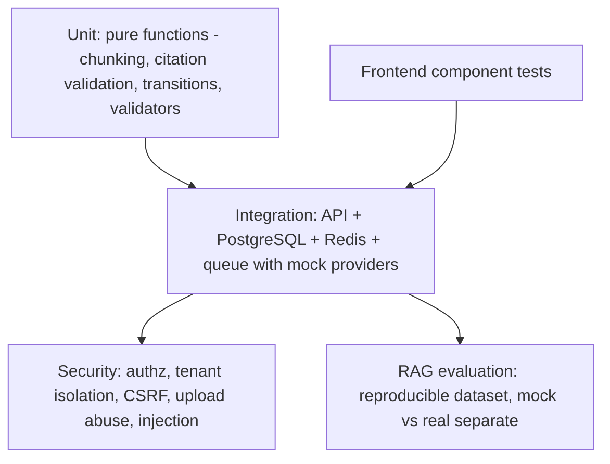

# TESTING.md

> **Status: PLANNED.** No tests exist yet. The results log at the bottom is intentionally empty. **Do not fabricate results, benchmarks or coverage percentages.**

## 1. Tools and conventions

| Need | Tool |
|---|---|
| Test runner (all packages) | **Vitest** |
| HTTP API tests | Supertest against the Express `app` (no network port needed) |
| React tests | React Testing Library + jsdom (Vitest environment) + a request-mocking layer such as MSW (decided in Phase 3) |
| DB integration tests | real PostgreSQL+pgvector in Docker (database `supportflow_test`), real Redis; migrations applied before the suite |
| CI | GitHub Actions with service containers for Postgres(pgvector) and Redis |
| Lint/format | ESLint, Prettier (separate CI step) |

Naming: `*.test.js` beside the code for unit tests; `tests/integration/*.test.js` for DB/Redis/API tests; `tests/security/*.test.js`; `docs/rag-eval/` for evaluation.

Rules:
- Each test sets up and cleans its own data (transactions or truncation); tests do not depend on order.
- Unit tests never touch the network. Integration tests use local Docker services only.
- **Real external AI/storage APIs are never called in CI or the default test command.** They run only in an explicitly named, manual suite (`npm run test:real-providers`) that requires keys and the owner's approval for cost.
- Time, randomness, and provider output are injected so tests are deterministic.

## 2. Test layers



## 3. Coverage matrix (required test areas)

| Area | Layer | Cases (non-exhaustive) | Phase |
|---|---|---|---|
| Registration & login | integration | success; duplicate email 409; weak password; always customer role; role in body ignored; wrong password and unknown email same response; rate limit | 2 |
| Refresh rotation | integration/security | rotates; old token rejected; reuse after grace revokes family; race inside grace does not revoke; expiry; absolute family limit; logout revokes; password change revokes; deactivated user cannot refresh | 2 |
| CSRF | security | missing `X-Requested-With`; foreign Origin; cookie not sent to non-auth paths | 2 |
| RBAC | integration | each endpoint × each role (matrix generated from API_SPEC) | 2 |
| Customer ownership | security | customer A cannot read/list/message customer B's ticket; 404 not 403 | 2 |
| Cross-organization | security | org B user cannot see org A tickets, documents, users, audit logs | 2, 4, 5 |
| Ticket transitions | unit+integration | allowed and disallowed; `open→resolved` needs agent message; customer reopen; `resolved_at` | 2 |
| Pagination/search/sort | integration | limits, bounds, whitelisted sort, search, SQL-injection strings | 2 |
| Audit log | integration | entries for key actions; append-only privilege (UPDATE/DELETE fail) | 2 |
| Upload validation | integration | oversize; wrong extension; wrong MIME; fake PDF (right extension, wrong bytes); encrypted PDF; duplicate hash | 4 |
| PDF extraction | unit | multi-page; page numbers; empty page; no-text PDF → `PDF_NO_TEXT` | 4 |
| Chunking & page metadata | unit | size/overlap respected; never crosses pages; unicode; tiny page | 4 |
| Embedding persistence | integration | rows carry config id and dimensions; DB rejects mismatched dimensions (composite FK, `vector_dims` CHECK); mock dims ≠ real dims scenarios | 4 |
| Dimension handling | integration | provider returns wrong length → non-retryable `EMBEDDING_DIMENSION_MISMATCH`; startup fails if env ≠ active config row | 4–5 |
| Queue retries & idempotency | integration | transient failure retried with backoff; non-retryable fails fast; same job twice → same chunks; crash simulated mid-job → recovers; reconciler re-enqueues stuck version | 4, 6 |
| **Safe replacement** | integration | replace while active: old stays searchable during processing; replacement fails → old still active and queryable; success → atomic swap, old superseded and purged; late older version cannot overwrite newer; reindex failure keeps active | 4 |
| Document delete | integration | retrieval excludes immediately; chunks purged; asset deleted only if unreferenced | 4 |
| Private downloads | security | no URL without auth; expired/forged HMAC token rejected; cross-org version id → 404; signed URL audited | 4 |
| Vector search | integration | returns nearest known chunk (mock embeddings); only active config; only active version; org filter; ordering; `EXPLAIN` check on a realistic dataset size (not tiny table) | 5 |
| Citation validation | unit+integration | out-of-range number removed; fabricated document/page ignored; zero valid citations → `insufficient_evidence`; malformed JSON handled | 5 |
| Empty/irrelevant retrieval | integration | no chunks → no LLM call; below threshold; unrelated question | 5 |
| Prompt injection | integration/eval | injected PDF text; injected ticket text; instruction to reveal system prompt; instruction to cite fake source | 5, 7 |
| Human review | integration | approve inserts message authored by agent with `ai_approved`; edit_approve stores final text; reject; ticket status unchanged; cannot approve non-answered; double review blocked; stale-source warning | 5 |
| Redis cache | integration | hit/miss; TTL; invalidation via version counter; customer cache not visible to other customer/agent view; org isolation; Redis down → bypass | 6 |
| Rate limits | integration | thresholds, `429` + `Retry-After`; per-user vs per-IP; insurance limiter when Redis down | 6 |
| Missing/invalid env | unit | each required variable missing → clear startup error; weak secrets rejected; mock providers refused in production | 1, 6 |
| DB/Redis failures | integration | readiness 503; API error codes; recovers when dependency returns | 6 |
| Graceful shutdown | integration | SIGTERM lets in-flight job finish or requeue | 6 |
| Frontend | component | loading, empty, error, success states for login, tickets, documents, AI panel; protected routes; role-based nav; clickable source opens snippet panel | 3, 5 |
| Accessibility basics | component | labels, focus, keyboard on forms | 3 |
| Password hashing | unit | hash/verify; wrong password; parameter upgrade rehash; works in Docker image | 1–2 |

## 4. Mock-provider vs real-provider testing

| | Mock (default, CI) | Real (manual, approved) |
|---|---|---|
| Purpose | pipeline correctness, security checks, regression | actual retrieval/answer quality, latency, cost |
| Cost | none | possible API charges; owner approves each run |
| Determinism | fully deterministic | not deterministic; repeat runs, report variance |
| What it can prove | plumbing, validation, authorization, idempotency | quality estimates on our dataset |
| What it cannot prove | anything about real model quality | anything beyond our dataset |

Every report states provider, model, config name and commit.

## 5. RAG evaluation harness

See AI_RAG_DESIGN.md §7 for metrics. Planned layout:

```
docs/rag-eval/
  questions.json            # id, question, expectedOutcome, expectedSources[{doc,page}], tags
  rubric.md                 # groundedness scoring guide
  results/                  # one file per run, never edited after the fact
samples/knowledge-base/     # synthetic policy PDFs generated deterministically
scripts/rag-eval.js         # npm run eval:mock | npm run eval:real
```
Properties: fixed dataset version; fixed config; the harness prints a table and writes the result file; it fails (non-zero exit) if citation accuracy or injection resilience falls below thresholds that are set **after** the first honest baseline run, not invented up front.

## 6. Commands (planned)

```bash
npm test                      # all unit + component tests (fast, no services needed)
npm run test:integration      # needs: docker compose up -d postgres redis
npm run test:security
npm run test:frontend
npm run test:coverage         # report only what the tool prints
npm run eval:mock             # RAG evaluation with mock providers
npm run test:real-providers   # manual, needs keys, may cost money
npm run lint
```

## 7. Definition of done for a feature

1. Code and tests written together; new tests fail before the change and pass after.
2. Relevant suites run **by the agent or developer**, with actual output recorded.
3. Lint passes.
4. Docs updated; status moved to Implemented, and to Verified only with an evidence-log entry.

## 8. Results log (empty until real runs exist)

| Date | Commit | Command | Environment | Result | Notes |
|---|---|---|---|---|---|
| | | | | | *No runs recorded yet* |
